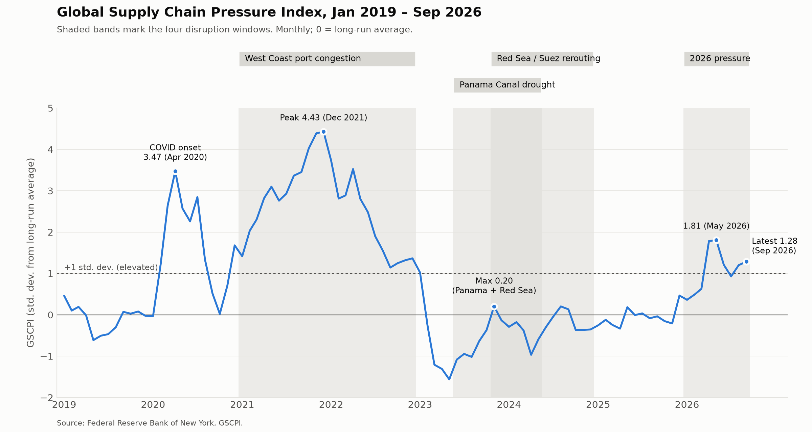

# Q1 — Macro pressure trend

**Question:** How has the NY Fed's Global Supply Chain Pressure Index moved from before the pandemic through the recent disruptions, and how do the spikes compare in size and duration?

**Primary data:** GSCPI (`data/processed/gscpi_2026-10-15.csv`), Jan 2019 – Sep 2026

## Answer

GSCPI is measured in standard deviations from its long-run average, so 0 is normal and +1 is clearly elevated. In 2019 the index hovered near zero. It jumped to 3.47 at COVID onset (Apr 2020), then rose again into the **West Coast congestion** window and peaked at **4.43 in Dec 2021**, the highest reading in the series. That episode was the largest and longest: every month of 2021–2022 sat above +1 (window mean 2.66), and the index didn't fall below +1 until Feb 2023.

The 2023–2024 shocks barely registered. During the **Panama Canal drought** the index never exceeded 0.20 (window mean −0.53), starting from a post-pandemic trough of −1.56 in May 2023. **Red Sea rerouting** also topped out at 0.20 (mean −0.25). These were lane-specific cost shocks hitting a slack global system, so they didn't show up in this broad index.

**Renewed 2026 pressure** is the first real spike since 2022. The index climbed from 0.47 in Dec 2025, jumped to 1.78 in Apr 2026, peaked at **1.81 in May**, and was still at 1.28 in Sep. That's about 40% of the 2021 peak, but it has stayed above +1 for 5 of 9 months and hasn't faded yet.

## Files

- `build_gscpi_chart.py`: builds the chart and per-window stats. Run `python q1-pressure/build_gscpi_chart.py`.
- `gscpi_disruption_windows.png`: the chart.
- `gscpi_window_stats.csv`: peak, mean, and months above 0 and +1 for each window.

Window dates are set in `WINDOWS` in the script: West Coast 2021-01 to 2022-12, Panama 2023-06 to 2024-05, Red Sea 2023-11 to 2024-12, and 2026 from 2026-01 to the latest month.
