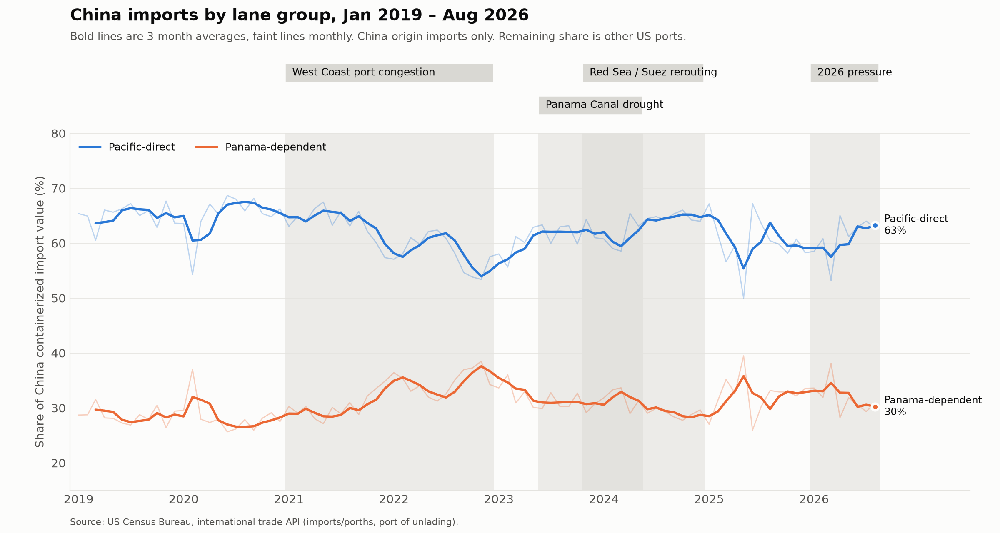

# Q2: Trade volume impact

**Question:** How have US trade volumes with key partners/regions shifted during the disruption windows, especially Asia-linked trade (Red Sea/Suez) and Latin America-linked trade (Panama Canal)?

**Primary data:** Census `imports/porths` (`data/processed/census_porths_5700_lanes_2026-10-15.csv`), Jan 2019 – Aug 2026

> **China-origin data only.** Every number below comes from US imports from China (country code 5700). We haven't checked whether other origins follow the same pattern, so treat it as unconfirmed for the rest of Asia, Europe, and Latin America.

## Answer

Each line shows a lane group's share of China containerized import value across all US ports. In 2019 the Panama-dependent ports (NY-NJ, Savannah, Virginia, Charleston, Houston) took about 28.5%, and the monthly share typically moved by about 1.5 percentage points.

**Yes, cargo shifts measurably, and the direction depends on the disruption type.**

- **West Coast congestion pushed cargo east.** The Panama-dependent share rose 8.4 points over 2021–2022, from 28.3% to 36.7%. That's more than five times normal monthly noise, as shippers routed around jammed LA/Long Beach.
- **Chokepoint shocks pulled it back west, but only a little.** During the Panama drought the share ended where it started (31.3% before and at the end), after swinging between 30.6% and 32.9% on the 3-month average. It had already been falling since its Nov 2022 peak, so the drought added no clear extra shift. Red Sea rerouting coincided with a 2.3-point drop to 28.7%, about the 2019 level. Because the Panama and Red Sea windows overlap, we can't separate the two.
- **2026 also leans west:** down 2.7 points (32.9% → 30.2%), though month-to-month swings are large (38% in March, 28% in April).

Congestion at the ports themselves moved far more cargo than canal or Suez constraints did. The unshaded early-2025 spike is unexplained and we haven't investigated it. It may be tariff-related, but that's a guess, not a finding.

## Files

- `build_lane_share_chart.py`: builds the chart and per-window stats. Run `python q2-trade-volume/build_lane_share_chart.py`. It imports `WINDOWS` from `q1-pressure/build_gscpi_chart.py`, so both charts mark the same months.
- `lane_share_disruption_windows.png`: the chart.
- `lane_share_window_stats.csv`: the Panama-dependent share before and at the end of each window, plus the window mean against 2019. Shares use `containerized_value_usd`. "Before" is the three months before a window starts, and "end" is its last three months.
