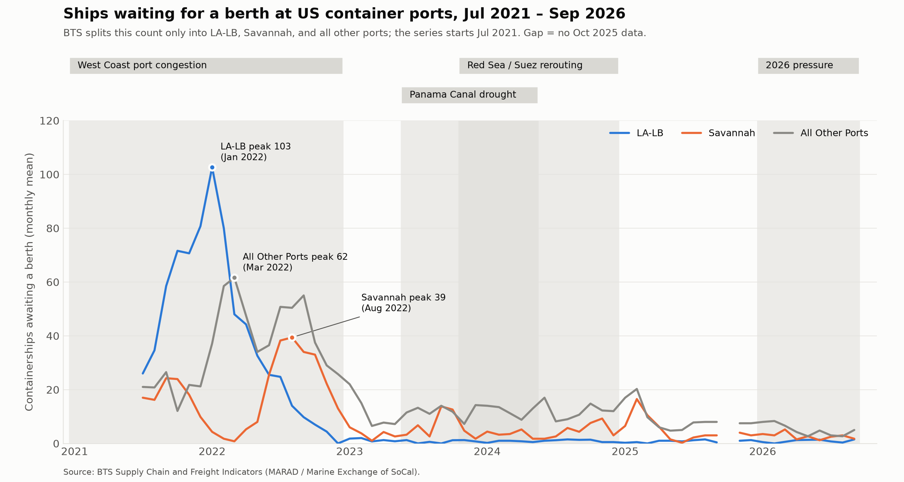
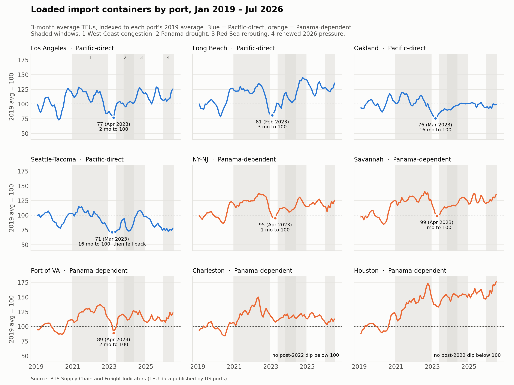
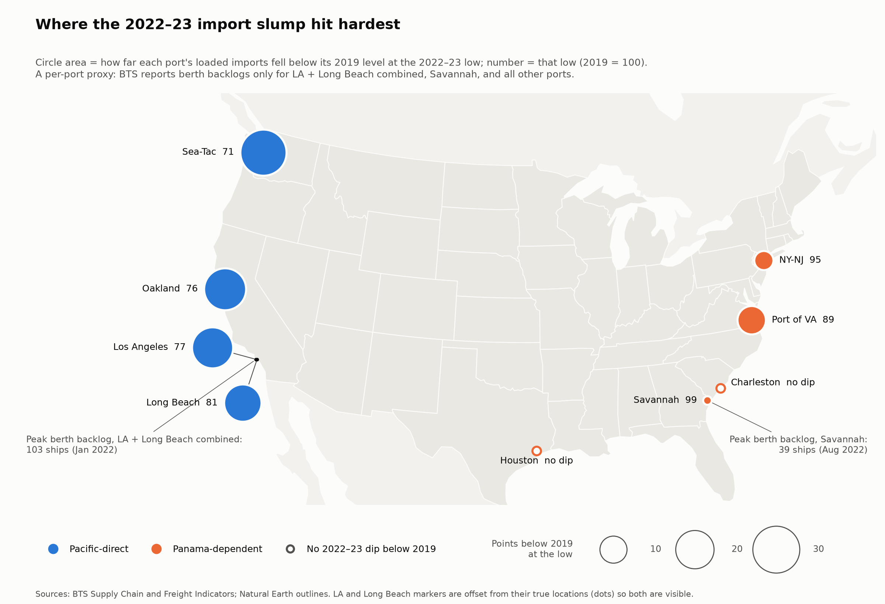

# Q3: Port-level resilience

**Question:** Which US ports saw the worst congestion, and which recovered fastest?

**Primary data:** BTS Supply Chain and Freight Indicators (`data/processed/bts_port_indicators_2026-10-15.csv`)

> **Data limits.** BTS counts ships waiting for a berth only for **LA-LB, Savannah, and all other ports combined**, and only from **Jul 2021**. So congestion can't be ranked across all 9 ports directly. Throughput (loaded import TEUs) does cover all 9 ports from Jan 2019, through Jul 2026. A throughput drop isn't the same as congestion: the 2023 slump also reflects the post-pandemic fall in import demand.

On the map, circle size is a **per-port proxy, not the berth backlog**. BTS counts waiting ships only for LA + Long Beach combined, Savannah, and all other ports, so there's no backlog figure for each of the 9 ports. Instead, each circle shows how far that port's loaded imports fell below its 2019 level at the 2022–23 low. That's the same trough as in the small multiples. The two backlog peaks BTS does publish are added as notes.

## Answer

**Worst congestion: LA-LB.** An average of 103 ships waited for a berth in Jan 2022, more than all other US ports combined (62 at their Mar 2022 peak). Savannah was hit later: its backlog peaked at 39 in Aug 2022, as cargo shifted east (see Q2).

**Backlogs cleared fastest at LA-LB and Savannah.** Both fell below a quarter of their peak within 5 months, versus 11 months for all other ports. LA-LB has stayed near zero since Dec 2022, but Savannah flared up again (14 ships in Sep 2023, 17 in Feb 2025).

**The throughput slump hit Pacific ports hardest.** In early 2023, West Coast imports fell to 71–81% of their 2019 level, versus 89–99% for NY-NJ, Savannah, and Virginia. Charleston and Houston didn't dip below 100 at all after 2022. LA and Long Beach were back to 2019 volume within 2–3 months. Oakland took 16 months. Seattle-Tacoma took 16 months and then fell back, and at 78 in Jul 2026 it's the one port clearly below its 2019 level. Houston grew the most, reaching 176.

**Later windows didn't congest ports.** During the Panama, Red Sea, and 2026 windows, LA-LB averaged under 1 ship waiting, Savannah about 3–5, and all other ports 5–12. By this measure, the 2026 pressure in Q1 isn't port congestion.

## Files

- `build_port_charts.py`: builds both charts and the stats tables. Run `python q3-ports/build_port_charts.py`. It imports `WINDOWS` from `q1-pressure/build_gscpi_chart.py`, the same as Q2.
- `port_backlog.png` and `port_throughput_small_multiples.png`: the charts.
- `build_port_map.py` and `port_map.png`: the port map. Run it after `build_port_charts.py`, since it reads both stats CSVs. Port coordinates come from `scripts/port_locations.py`, and the outlines from Natural Earth via `scripts/map_outlines.py`. The LA and Long Beach markers are drawn offshore, with leader lines to their true locations, because the two ports are about 8 km apart.
- `port_backlog_stats.csv`: backlog peak, months to clear (first month below 25% of peak), and the mean for each window.
- `port_throughput_stats.csv`: for each port, the trough index between Jul 2022 and Dec 2023, months from that trough back to 100, and the latest value. Throughput uses a 3-month average indexed to each port's 2019 mean. Lane groups come from the Q2 Census lanes table.
