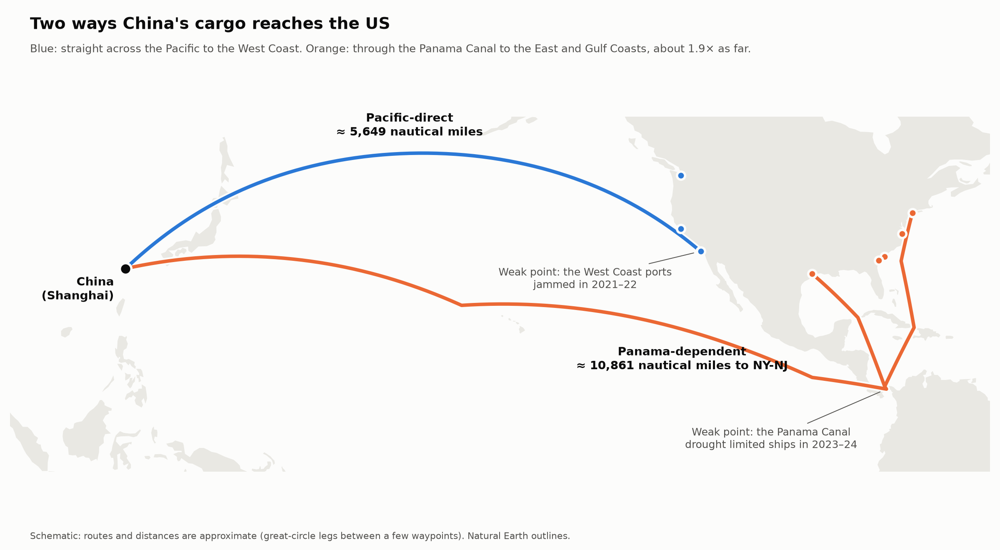
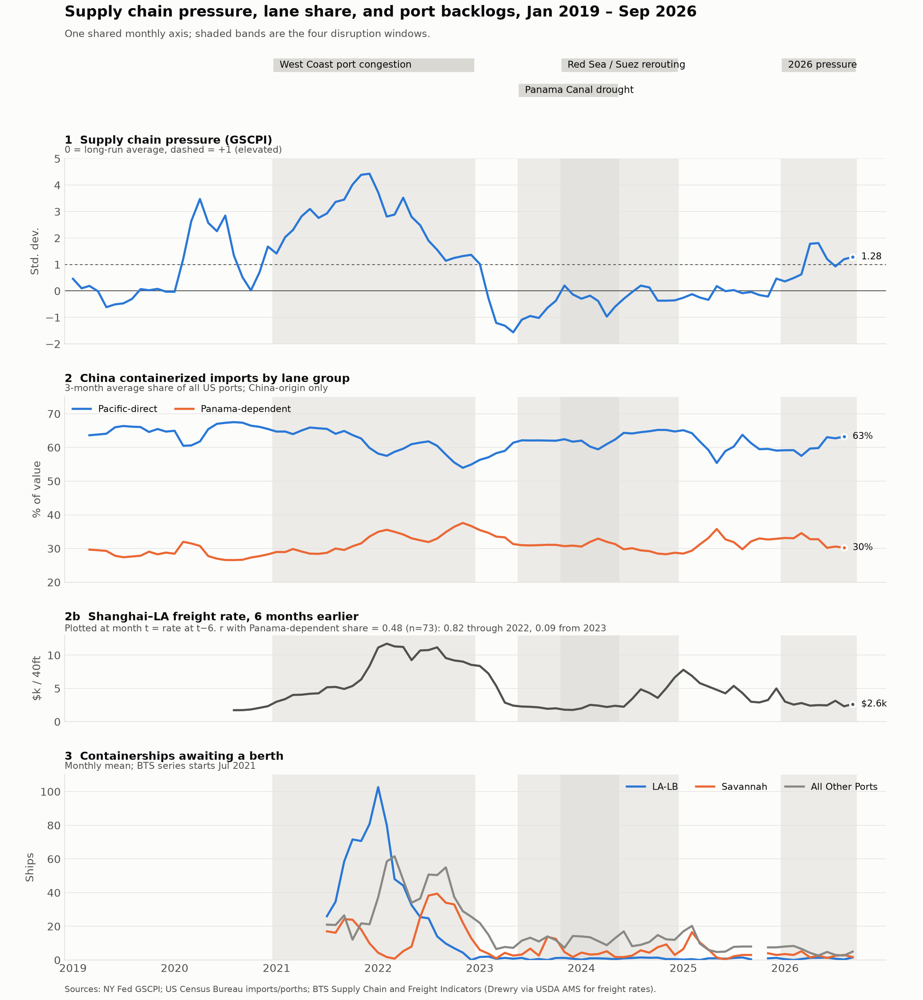

# Q4: Synthesis

**Question:** Combining Q1–Q3, which specific lanes came out more resilient, and why?

**Primary data:** Outputs of q1–q3, plus the Shanghai–LA spot rate from `data/processed/bts_port_indicators_2026-10-15.csv`

The route map shows why the two lane groups react to different disruptions. Pacific-direct cargo makes one short crossing, so its weak point is the West Coast ports themselves. Panama-dependent cargo travels about 1.9× as far and must pass through the canal. The map is a schematic: routes are great-circle legs between a few waypoints, so paths and distances are approximate.

> **Caveat: four episodes support a pattern, not a proven result.** The findings below rest on four disruption windows. Two of them (Panama and Red Sea) overlap and can't be separated, and the lane data is China-origin only. Demand swings, tariffs, and carrier decisions also move these series. Read this as a consistent pattern worth testing, not as established cause and effect.

## Which lanes held up against which disruption

**Port congestion (West Coast, 2021–22): the Panama-dependent lane held up best.** LA-LB carried the worst backlog (103 ships, Jan 2022) and then the deepest throughput slump (71–81% of 2019 at Pacific ports in early 2023). Meanwhile the East/Gulf share of China imports rose 8.4 points. Houston and Charleston never fell below their 2019 volume after 2022. That resilience had limits: Savannah built its own backlog (39 ships, Aug 2022) once the diverted cargo arrived.

**Chokepoint disruptions (Panama drought and Red Sea, 2023–24): the Pacific-direct lane held up best.** During the Panama drought alone, the Panama-dependent share stayed flat (31.3% before and after). The 2.3-point drop back to its 2019 level came in the overlapping Red Sea window. LA and Long Beach were back above 2019 volume by mid-2023. No port backed up (LA-LB averaged under 1 ship waiting) and GSCPI stayed near zero, so these were small, lane-specific shocks.

**Renewed 2026 pressure looks like the chokepoint pattern so far.** GSCPI is elevated (1.81 peak, 1.28 in Sep), the share is leaning west (−2.7 points), and port backlogs are near record lows. Within Pacific-direct, LA and Long Beach are the resilient ports; Oakland recovered slowly, and Seattle-Tacoma recovered once (Jul 2024) and then fell back to 78 in Jul 2026, the one port clearly below its 2019 level. Within Panama-dependent, Houston is the strongest.

## Freight rate at a six-month lag

The pitch deck (slide 8) claims r ≈ 0.45 between the Shanghai–LA rate six months earlier and lane share. With the full data, the Pearson r against the Panama-dependent share is **0.48** (n = 73 months, Aug 2020 – Aug 2026), so the headline holds. But:

- **It's driven by one episode.** r is **0.82** through 2022 (n = 29) but only **0.09** from 2023 on (n = 44). The six-month lag reflects how the 2021–22 rate spike preceded the eastward shift. Since then, it hasn't been a reliable signal.
- **Six months isn't a sharp peak.** r rises steadily from 0.02 at lag 0 to 0.53 at nine months (see `lag_correlations.csv`).
- **GSCPI is weaker:** 0.08 same-month and 0.28 at six months (deck: 0.05 / 0.25).
- **Neither is significance-tested.** Both series are smooth and trending, so monthly observations aren't independent, and the effective sample is far smaller than n.

The rate climbed from $3.1k in Apr 2026 to $7.8k in Sep 2026. If the 2021–22 relationship held, that would point to an eastward shift in early 2027, off this chart. Given the post-2023 r of 0.09, treat that as something to watch, not a forecast.

## Files

- `build_synthesis_chart.py`: builds the chart and lag table. Run `python q4-synthesis/build_synthesis_chart.py`. It imports the loaders from the Q1–Q3 scripts and `WINDOWS` from Q1, so all four charts use the same numbers and months.
- `synthesis_small_multiples.png`: the chart. The freight rate sits in its own strip (2b) under the lane share rather than on a second y-axis.
- `build_route_map.py` and `route_map.png`: the route schematic. Distances are computed along the drawn paths. Port and waypoint coordinates come from `scripts/port_locations.py`.
- `build_scorecard.py`, `episode_scorecard.png`, and `episode_scorecard.csv`: one row per disruption window, with columns for peak pressure, cargo shift, and LA-Long Beach ships waiting. Each column has its own baseline and scale, so you compare episodes down a column and read one episode across its row. Numbers come from the Q1-Q3 stats CSVs, and the CSV records what was drawn. Run `python q4-synthesis/build_scorecard.py`.
- `build_rate_scatter.py` and `rate_vs_share_scatter.png`: one dot per month, the freight rate six months earlier against the Panama-dependent share. It shows the correlation split: r = 0.82 through 2022 versus 0.09 from 2023 on. The script recomputes r and checks it against `lag_correlations.csv`. Run `python q4-synthesis/build_rate_scatter.py`.
- `lag_correlations.csv`: r between the freight rate or GSCPI at month t − lag and the Panama-dependent share at month t, for lags 0–12. The six-month row adds the split before and after 2023.
